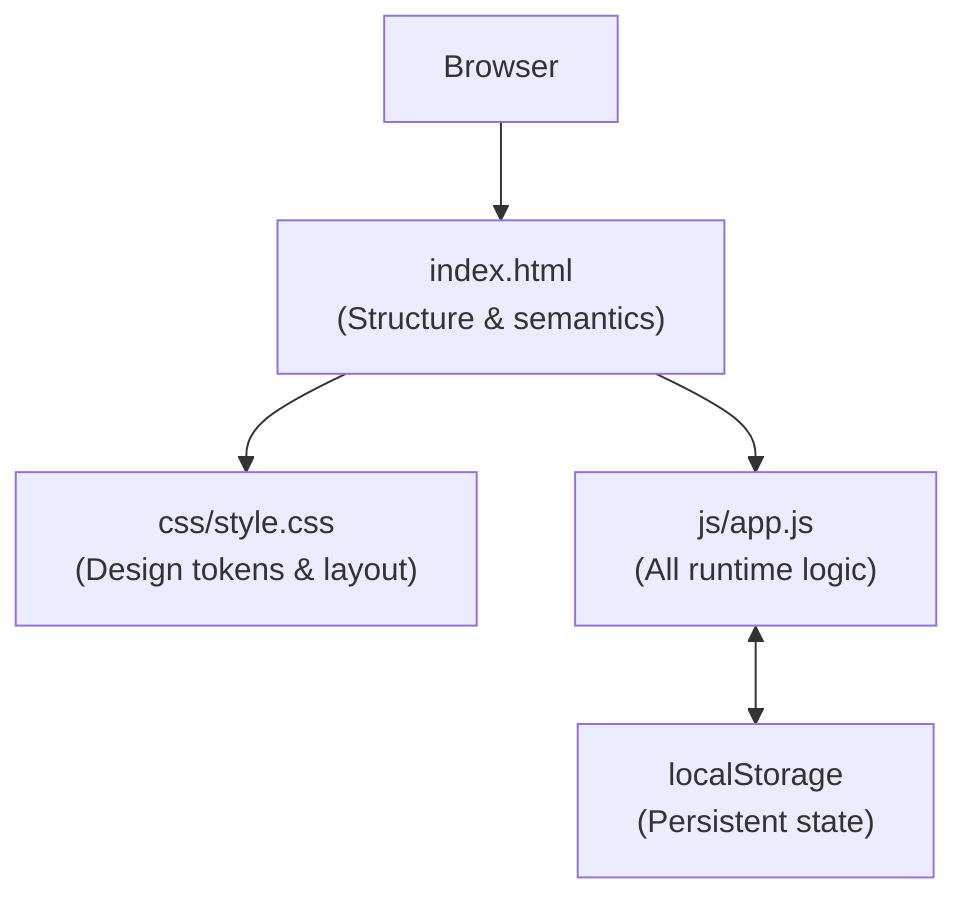
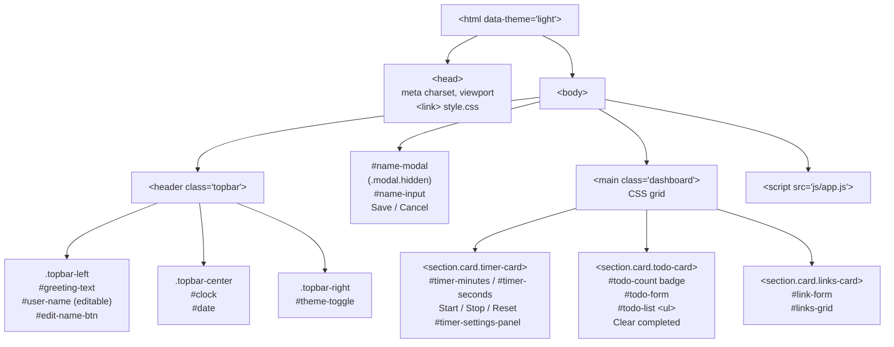
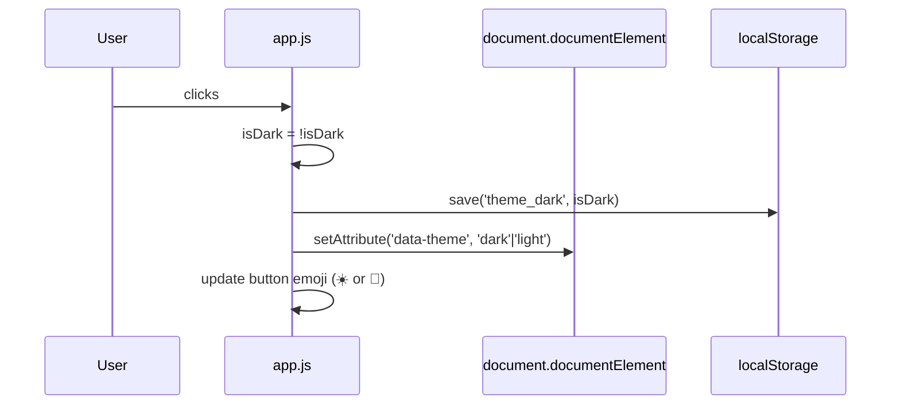
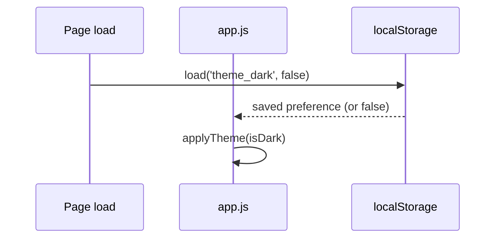
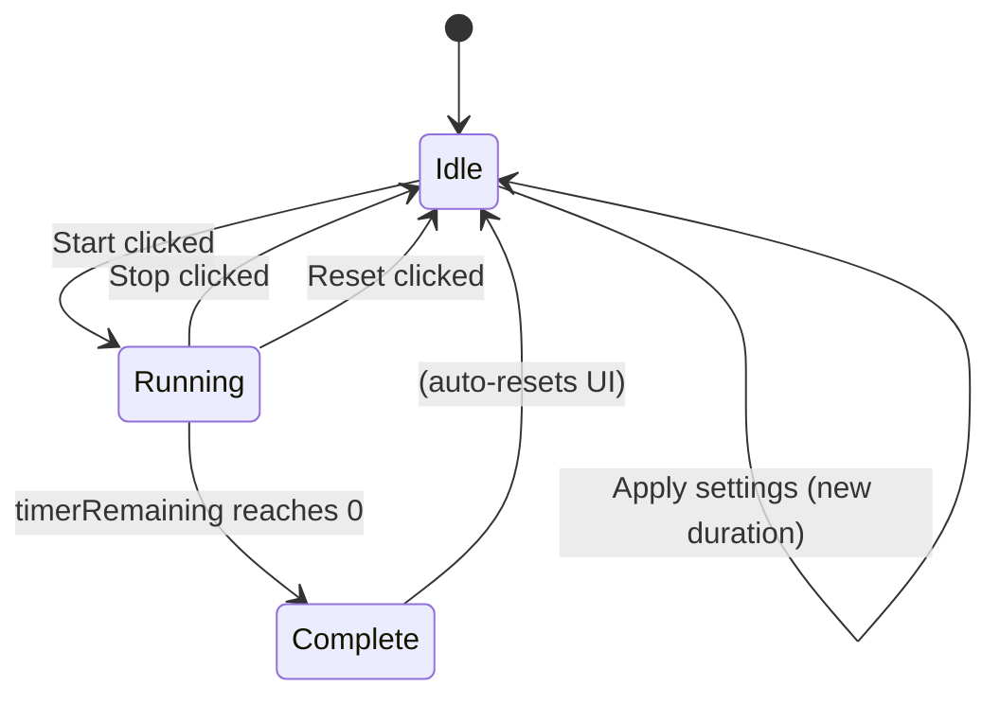
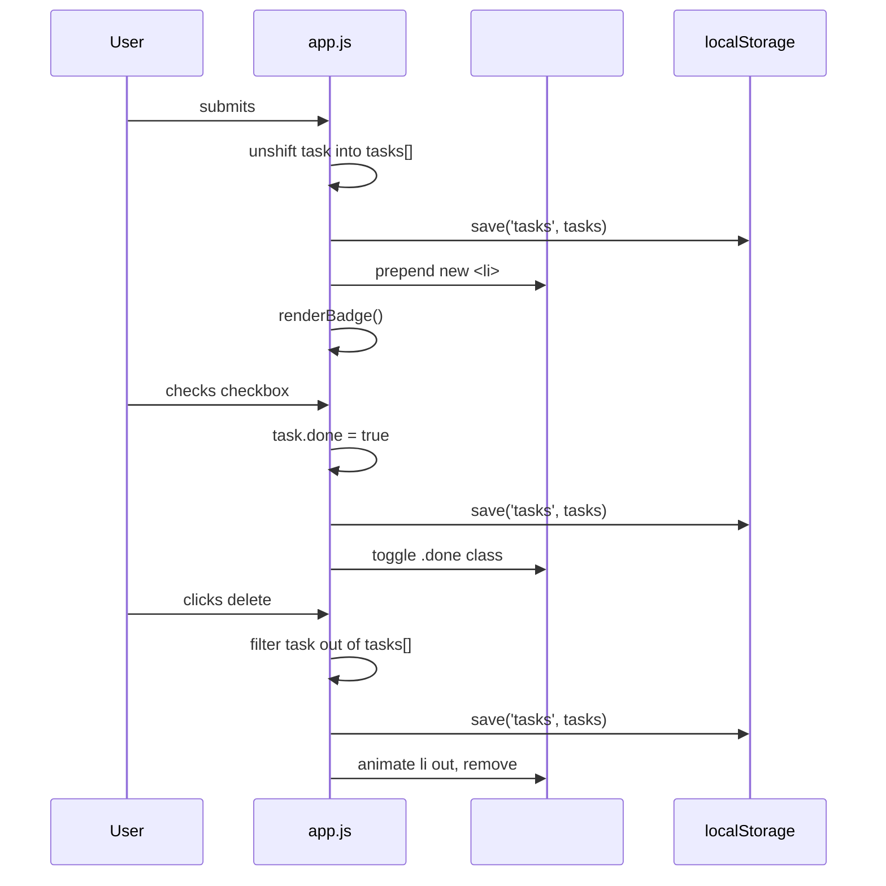

# Design Document: Todo Dashboard

## Overview

The Todo Dashboard is a self-contained, client-side productivity page that runs entirely in the browser with no build step, no server, and no external dependencies. It combines four interactive widgets — a live clock with contextual greeting, a Pomodoro-style focus timer, a persistent to-do list, and a quick-links launcher — all stored in `localStorage` so the user's data survives page reloads. The UI supports light and dark themes, is keyboard-accessible, and adapts to small screens through CSS media queries.

## Architecture

The application is a classic multi-file static website: one HTML file defines the document structure, one CSS file owns all visual styling, and one JavaScript file contains all runtime behaviour. There is no module bundler, no framework, no transpilation, and no network requests at runtime.



Data flows in one direction at runtime: user interaction triggers JavaScript event handlers, which update in-memory state, persist changes to `localStorage`, and re-render the relevant DOM fragment.

## File Structure

```
/
├── index.html          # Single-page document; all markup lives here
├── css/
│   └── style.css       # Design tokens, component styles, responsive rules
└── js/
    └── app.js          # All JS — helpers, clock, theme, name, timer, tasks, links
```

## HTML Structure



### Semantic roles

| Element | Role |
|---|---|
| `<header class="topbar">` | Site-level banner |
| `<main class="dashboard">` | Primary content landmark |
| `<section class="card">` | Distinct thematic widget |
| `<ul id="todo-list">` | Ordered task collection (`aria-label="Tasks"`) |
| `#name-modal` | `role="dialog"`, `aria-modal="true"`, `aria-labelledby="name-modal-title"` |
| `#timer-display` | `aria-live="polite"`, `aria-atomic="true"` — announces countdown changes to screen readers |

## CSS Theming

### Design Tokens

All colours, radii, shadows, and transition durations are declared as CSS custom properties on `:root`. A second `[data-theme="dark"]` rule block overrides each token for the dark palette. Switching themes requires only a single attribute write on `<html>`.

```
:root {
  --bg, --surface, --surface-2, --border
  --text, --text-muted
  --accent (#5b6af7), --accent-dark, --accent-light
  --danger, --danger-light
  --success
  --radius (12px), --radius-sm (8px)
  --shadow, --shadow-md
  --transition (.18s ease)
  --font
}

[data-theme="dark"] { /* overrides all tokens above */ }
```

### Theme Switching Mechanism



On page load, `applyTheme(load('theme_dark', false))` restores the user's last choice before any paint.

### Animations

| Name | Trigger | Effect |
|---|---|---|
| `slide-in` | Todo item / link chip creation | Fades in from -6 px above |
| `fade-in` | Modal open | Opacity 0 → 1 |
| `blink` | Timer colon separator | Opacity alternates at 50 % on 1 s step |

## JavaScript Module Breakdown

`app.js` is structured as seven named sections executed sequentially at page load. There are no ES modules or classes; all state lives in module-level `let`/`const` variables.

### Section 1 — Helpers

| Function | Signature | Purpose |
|---|---|---|
| `load` | `(key: string, fallback: any) → any` | `localStorage.getItem` wrapped in try/catch; parses JSON, returns `fallback` on miss or parse error |
| `save` | `(key: string, value: any) → void` | `JSON.stringify` then `localStorage.setItem` |
| `pad` | `(n: number) → string` | Zero-pads to 2 digits (`String(n).padStart(2, '0')`) |

### Section 2 — Clock & Greeting

`updateClock()` runs immediately and then every 1 000 ms via `setInterval`. It writes to three DOM nodes:

| Node | Format |
|---|---|
| `#clock` | `HH:MM:SS AM/PM` (12-hour) |
| `#date` | `Day, Month D, YYYY` |
| `#greeting-text` | Determined by hour (see table below) |

**Greeting rules:**

| Hour range | Greeting |
|---|---|
| 0–11 | Good morning |
| 12–16 | Good afternoon |
| 17–20 | Good evening |
| 21–23 | Good night |

### Section 3 — Theme



`applyTheme(dark)`:
1. Sets `data-theme` attribute on `<html>`
2. Updates toggle button `textContent` and `title`

### Section 4 — Name

- Default value: `"Friend"`
- `localStorage` key: `user_name`
- Modal opened by clicking `#user-name` span **or** `#edit-name-btn`
- Modal closed by: Cancel button, Escape key, clicking the semi-transparent backdrop
- Save triggered by: Save button or Enter key
- An empty input is ignored — the previously saved name is not overwritten

### Section 5 — Focus Timer

**State variables:**

| Variable | Type | Initial value |
|---|---|---|
| `timerDuration` | `number` (minutes) | `load('timer_duration', 25)` |
| `timerRemaining` | `number` (seconds) | `timerDuration * 60` |
| `timerInterval` | `number \| null` | `null` |
| `timerRunning` | `boolean` | `false` |

**Control flow:**



- While running, `document.title` is updated to `MM:SS – Dashboard`
- On completion: fires `Notification` if `Notification.permission === 'granted'`; falls back to `alert()` otherwise
- Settings panel (1–120 min) toggled by ⚙️ button; Apply validates range, persists to `localStorage`, resets all timer state

### Section 6 — To-Do List

**Task schema:**
```javascript
{ id: string, text: string, done: boolean }
// id = Date.now().toString() at creation time
```

**localStorage key:** `tasks`

**Lifecycle:**



**Edit behaviour:**
- Clicking ✏️ sets `contenteditable="true"` on the text span and changes the button to ✔️
- Enter or ✔️ saves; empty text reverts without writing
- Escape reverts without saving

**Badge:** shows count of `tasks.filter(t => !t.done).length`; hidden when `tasks.length === 0`

### Section 7 — Quick Links

**Link schema:**
```javascript
{ id: string, name: string, url: string }
// id = Date.now().toString() at creation time
```

**localStorage key:** `quick_links`

**URL normalisation:** `normaliseUrl(url)` prepends `https://` when no protocol is present.

**Validation:** `new URL(url)` — throws on invalid URLs; caught with an `alert()`.

**Chip rendering:** Each link renders as a `.link-chip` pill with an `<a>` (opens `target="_blank"` with `rel="noopener noreferrer"`) and a `✕` delete button.

## Components and Interfaces

### Component 1: Clock & Greeting

**Purpose**: Displays the current time, full date, and a time-of-day greeting in the header.

**Interface**:
```javascript
function updateClock(): void
// Reads: new Date()
// Writes: #clock, #date, #greeting-text
```

**Responsibilities**:
- Format and display 12-hour time with AM/PM and seconds
- Format and display the full date
- Derive the greeting string from the current hour

---

### Component 2: Theme Toggle

**Purpose**: Switches the page between light and dark palettes and persists the preference.

**Interface**:
```javascript
function applyTheme(dark: boolean): void
// Writes: document.documentElement[data-theme], #theme-toggle textContent
```

**Responsibilities**:
- Apply the correct `data-theme` attribute value to `<html>`
- Keep the toggle button emoji and title in sync with the active theme
- Persist the preference to `localStorage` on user interaction

---

### Component 3: Name Editor

**Purpose**: Lets the user set a personal display name shown in the header greeting.

**Interface**:
```javascript
function renderName(): void       // Reads localStorage, writes #user-name
function openNameModal(): void    // Shows #name-modal, focuses #name-input
function closeNameModal(): void   // Hides #name-modal
```

**Responsibilities**:
- Open the modal on click of `#user-name` or `#edit-name-btn`
- Validate that the input is non-empty before saving
- Close on Save, Cancel, Escape, or backdrop click

---

### Component 4: Focus Timer

**Purpose**: Countdown timer (default 25 min) with Start / Stop / Reset controls and an optional settings panel.

**Interface**:
```javascript
function renderTimer(): void               // Updates #timer-minutes, #timer-seconds, document.title
function setTimerButtons(running: boolean): void  // Toggles disabled state of Start/Stop
```

**Responsibilities**:
- Count down in one-second steps
- Update `document.title` while running
- Fire a `Notification` (or `alert` fallback) on completion
- Validate and persist a custom duration (1–120 min)

---

### Component 5: To-Do List

**Purpose**: A persistent, editable task list with per-item completion and deletion.

**Interface**:
```javascript
function renderTasks(): void               // Full re-render of #todo-list
function renderBadge(): void               // Updates #todo-count
function createTaskEl(task: Task): HTMLLIElement  // Builds one list item
function saveTasks(): void                 // Persists tasks[] to localStorage
```

**Responsibilities**:
- Prepend new tasks and persist immediately
- Support inline editing via `contenteditable`
- Animate item deletion
- Maintain the incomplete-task count badge
- Clear all completed tasks on demand

---

### Component 6: Quick Links

**Purpose**: A collection of labelled shortcut links the user can open in a new tab.

**Interface**:
```javascript
function renderLinks(): void               // Full re-render of #links-grid
function createLinkEl(link: Link): HTMLDivElement  // Builds one chip
function saveLinks(): void                 // Persists links[] to localStorage
function normaliseUrl(url: string): string // Prepends https:// if no protocol present
```

**Responsibilities**:
- Normalise and validate URLs before saving
- Open links in a new tab with `noopener noreferrer`
- Animate chip deletion

---

## Data Models

### Model 1: Task

```javascript
interface Task {
  id: string;    // Date.now().toString() — unique within a session
  text: string;  // Non-empty task description (max 120 chars from HTML input)
  done: boolean; // Completion state
}
```

**Validation Rules**:
- `text` must be a non-empty string after trimming; empty input is rejected silently
- `id` must be unique across all tasks in the array

---

### Model 2: Link

```javascript
interface Link {
  id: string;   // Date.now().toString()
  name: string; // Display label (max 30 chars from HTML input)
  url: string;  // Fully qualified URL (normalised, validated via new URL())
}
```

**Validation Rules**:
- `url` must pass `new URL()` after normalisation; invalid URLs trigger an `alert()` and block saving
- `name` must be a non-empty string after trimming

---

### Model 3: localStorage Schema

| Key | JSON type | Constraint | Default |
|---|---|---|---|
| `theme_dark` | `boolean` | `true` or `false` | `false` |
| `user_name` | `string` | Non-empty | `"Friend"` |
| `timer_duration` | `number` | Integer in [1, 120] | `25` |
| `tasks` | `Task[]` | Array (may be empty) | `[]` |
| `quick_links` | `Link[]` | Array (may be empty) | `[]` |

---

## Error Handling

### Error Scenario 1: Corrupt localStorage Value

**Condition**: A stored value cannot be parsed by `JSON.parse` (e.g., manually edited or truncated by the browser).  
**Response**: `load()` catches the exception and returns the `fallback` argument.  
**Recovery**: The application starts fresh for that key; data corruption is silently contained to the affected key.

### Error Scenario 2: Invalid Quick-Link URL

**Condition**: The user submits a URL string that cannot be parsed by `new URL()` after normalisation.  
**Response**: `alert('Please enter a valid URL.')` is shown.  
**Recovery**: The form is not cleared; the user can correct the input and resubmit.

### Error Scenario 3: Invalid Timer Duration

**Condition**: The user enters a non-integer, zero, negative number, or value above 120 in the timer settings input.  
**Response**: The Apply handler returns early without updating state.  
**Recovery**: The timer settings panel remains open; no state change occurs.

### Error Scenario 4: Notification Permission Denied

**Condition**: The user denies the browser notification permission, or the `Notification` API is unavailable.  
**Response**: The timer completion falls back to `window.alert()`.  
**Recovery**: No action required; `alert()` provides equivalent messaging.

---

## Data Model

| `localStorage` key | Type | Schema | Default |
|---|---|---|---|
| `theme_dark` | `boolean` | `true` / `false` | `false` |
| `user_name` | `string` | Any non-empty string | `"Friend"` |
| `timer_duration` | `number` | Integer 1–120 (minutes) | `25` |
| `tasks` | `array` | `{ id: string, text: string, done: boolean }[]` | `[]` |
| `quick_links` | `array` | `{ id: string, name: string, url: string }[]` | `[]` |

All values are stored as JSON strings. `load()` returns the fallback for any key that is absent, null, or unparseable.

## State Management

There is no state container or reactive framework. Each feature section owns its own module-level variables and exposes an explicit `render*()` function:

| Feature | State variables | Render function |
|---|---|---|
| Clock | — (no persistent state) | `updateClock()` — runs on interval |
| Theme | `isDark` | `applyTheme(dark)` |
| Name | — (read from `localStorage` on demand) | `renderName()` |
| Timer | `timerDuration`, `timerRemaining`, `timerRunning`, `timerInterval` | `renderTimer()`, `setTimerButtons(running)` |
| To-do | `tasks[]` | `renderTasks()`, `renderBadge()`, `createTaskEl(task)` |
| Quick links | `links[]` | `renderLinks()`, `createLinkEl(link)` |

The pattern is: **event handler → mutate state → persist → update DOM**. Full re-renders (`renderTasks()`, `renderLinks()`) are used only when the entire list changes (e.g., "Clear completed"). Incremental DOM updates (prepend, append, animate-out) are used for single-item additions and deletions to avoid unnecessary work.

## Accessibility

| Feature | Implementation |
|---|---|
| Timer countdown announcements | `aria-live="polite"` + `aria-atomic="true"` on `.timer-display` |
| Name modal | `role="dialog"`, `aria-modal="true"`, `aria-labelledby="name-modal-title"`, focus moves to input on open |
| Task list | `<ul aria-label="Tasks">` with `<li>` items |
| Checkboxes | `aria-label="Mark task as done"` |
| Edit / delete buttons | `aria-label="Edit task"` / `aria-label="Delete task"` |
| Links container | `role="list"`, each chip has `role="listitem"` |
| Delete link buttons | `aria-label="Remove {name}"` |
| Theme toggle | `title` and `aria-label` updated with every mode switch |
| Keyboard navigation | Enter = save (name modal, timer settings, task add, task edit); Escape = cancel/close (name modal, task edit); backdrop click = close modal |
| Accent colour on inputs | `accent-color: var(--accent)` on checkboxes |

## Responsive Design

| Breakpoint | Changes |
|---|---|
| `max-width: 600px` | Topbar wraps to multiple lines; reduced font sizes for `.topbar-left` / `.topbar-right`; clock shrinks from `1.6rem` to `1.3rem`; timer display from `4rem` to `3rem`; dashboard padding and gap reduced |
| `max-width: 420px` | Link form switches from 3-column grid to single column |

The dashboard grid uses `repeat(auto-fit, minmax(300px, 1fr))`, so cards reflow from three columns to one automatically as the viewport narrows — no JavaScript involved.

## Correctness Properties

*A property is a characteristic or behavior that should hold true across all valid executions of a system — essentially, a formal statement about what the system should do. Properties serve as the bridge between human-readable specifications and machine-verifiable correctness guarantees.*

### Property 1: Storage round-trip

For any JSON-serialisable value `v`, `load(key, fallback)` after `save(key, v)` returns a value deeply equal to `v`. `load(key, fallback)` never throws; it always returns either the parsed stored value or `fallback`.

**Validates: Requirements 2.2, 3.2, 4.2, 5.1, 6.1**

### Property 2: Timer countdown bounds

Each `setInterval` tick decrements `timerRemaining` by exactly 1. `timerRemaining` never goes below 0 because the interval is cleared when it reaches 0.

**Validates: Requirements 4.3, 4.4**

### Property 3: Timer reset invariant

After any reset or settings change, `timerRemaining` equals `timerDuration * 60`.

**Validates: Requirements 4.5, 4.7**

### Property 4: Timer settings validation

The Apply button only accepts timer durations in [1, 120]; any value outside that range is rejected without side effects.

**Validates: Requirements 4.6, 4.7**

### Property 5: Name persistence

Saving an empty string in the name modal does not overwrite the previously stored name. The displayed name always equals `load('user_name', 'Friend')` after `renderName()`.

**Validates: Requirements 2.5, 2.6**

### Property 6: Task identity

Every task object has a unique `id`. Deleting a task by `id` removes exactly that item; all other tasks remain unchanged.

**Validates: Requirements 5.8**

### Property 7: Badge accuracy

The badge count always equals `tasks.filter(t => !t.done).length` after any task mutation. "Clear completed" leaves only tasks where `done === false`.

**Validates: Requirements 5.4, 5.7**

### Property 8: URL validity

A link is only added when `new URL(normaliseUrl(url))` succeeds. `normaliseUrl` is idempotent for URLs that already include a protocol.

**Validates: Requirements 6.2, 6.3**

### Property 9: Theme consistency

After `applyTheme(dark)`, `document.documentElement.getAttribute('data-theme')` equals `'dark'` when `dark === true` and `'light'` otherwise. The toggle emoji is always `'☀️'` in dark mode and `'🌙'` in light mode.

**Validates: Requirements 3.3, 3.4, 3.5**

### Property 10: Greeting correctness

For any integer hour value in [0, 23], the greeting derived by `updateClock()` is exactly "Good morning" for hours in [0, 11], "Good afternoon" for [12, 16], "Good evening" for [17, 20], and "Good night" for [21, 23].

**Validates: Requirements 1.4, 1.5, 1.6, 1.7**

### Property 11: Empty task rejection

For any string composed entirely of whitespace characters, submitting it as a new task leaves the tasks array unchanged and does not write to Storage.

**Validates: Requirements 5.3**

### Property 12: Task edit revert on empty text

For any task with a non-empty saved text value, confirming an edit with an empty input reverts the displayed text to the saved value and does not write a new value to Storage.

**Validates: Requirements 5.10**

### Property 13: Chip delete aria-label

For any Link with label `name`, the rendered Link_Chip delete button carries an `aria-label` attribute equal to `"Remove " + name`.

**Validates: Requirements 8.9**

## Testing Strategy

### Unit Testing Approach

Each pure helper and business-logic function can be tested in isolation:

- `load` / `save` — mock `localStorage`, verify JSON round-trip and fallback behaviour
- `pad` — boundary values: `0 → "00"`, `9 → "09"`, `10 → "10"`, `99 → "99"`
- `normaliseUrl` — input without protocol, input with `http://`, input with `https://`
- `updateClock` — mock `Date`, verify correct 12-hour format, AM/PM, greeting rules at boundary hours (0, 12, 17, 21)
- Timer state machine — verify `timerRemaining` decrements correctly, stops at 0, resets to `timerDuration * 60`

### Property-Based Testing Approach

**Property Test Library**: fast-check

Properties suited to generative testing:
- For any valid task array, `renderBadge()` count equals `tasks.filter(t => !t.done).length`
- For any string `s`, `load(key, fallback)` after `save(key, s)` equals `s`
- For any integer `n` in [0, 59], `pad(n)` returns a 2-character string
- For any URL string accepted by `new URL()`, `normaliseUrl` produces a URL also accepted by `new URL()`

### Integration Testing Approach

End-to-end scenarios (e.g., with Playwright):
- Add a task → reload → task persists
- Toggle theme → reload → dark/light preference persists
- Change timer duration → reload → custom duration shown
- Save a name → reload → name shown in header
- Add a quick link → reload → chip appears

## Dependencies

There are no runtime dependencies. The project uses only:

| Resource | Version | Purpose |
|---|---|---|
| Browser-native `localStorage` | Built-in | Persistent client-side storage |
| Browser-native `Notification` API | Built-in | Timer completion alert |
| Browser-native `URL` constructor | Built-in | Quick-link URL validation |
| Mermaid (diagrams) | — | Used in this design document only; not in the app |

No npm, no CDN links, no external fonts or icons — the application loads entirely from the three local files.
